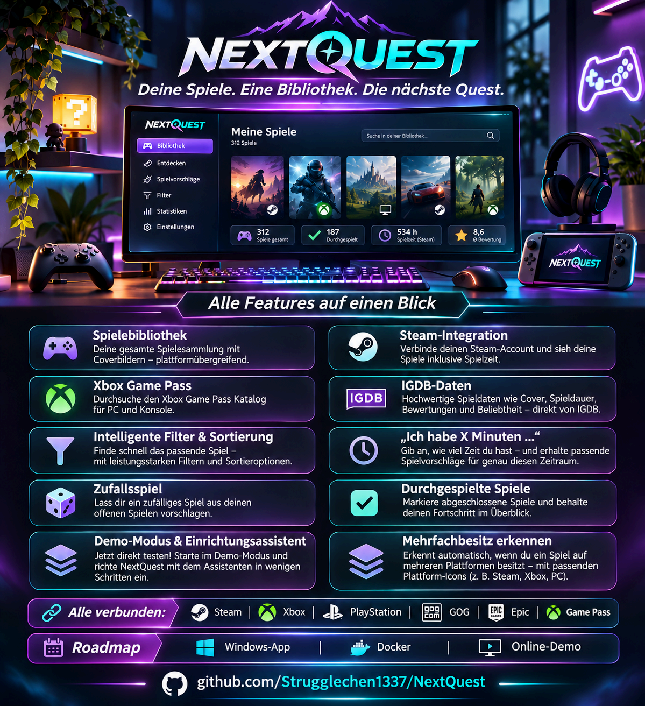
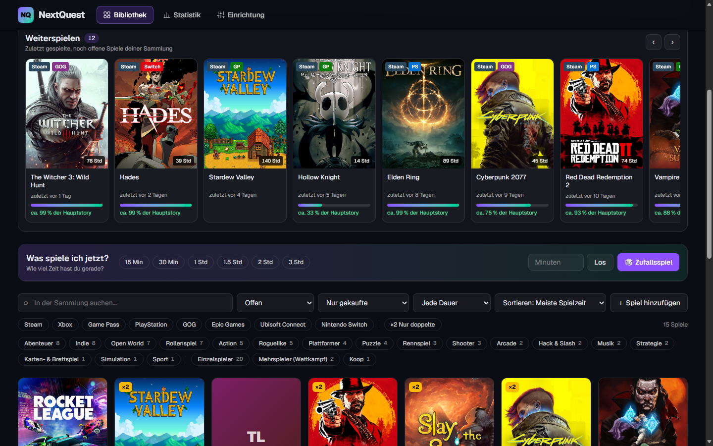
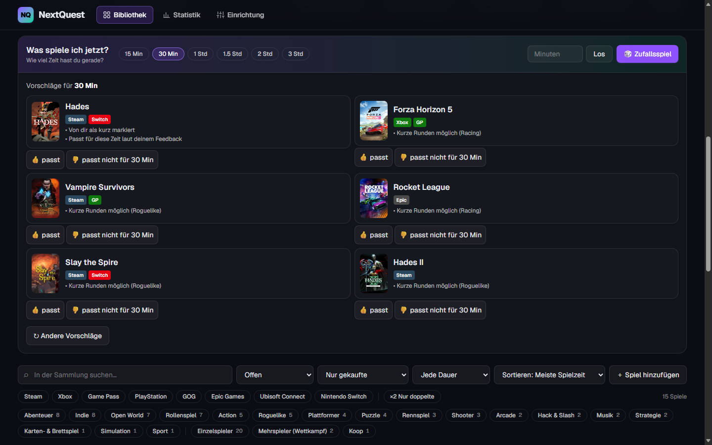
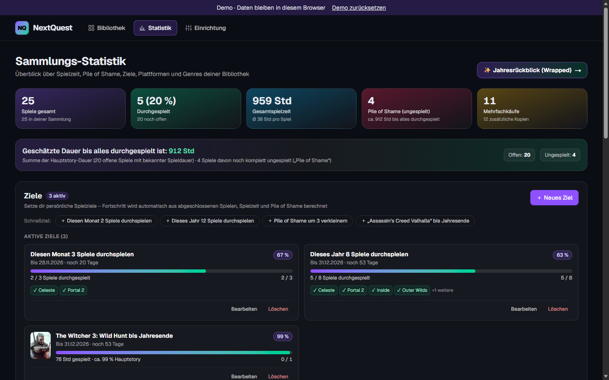
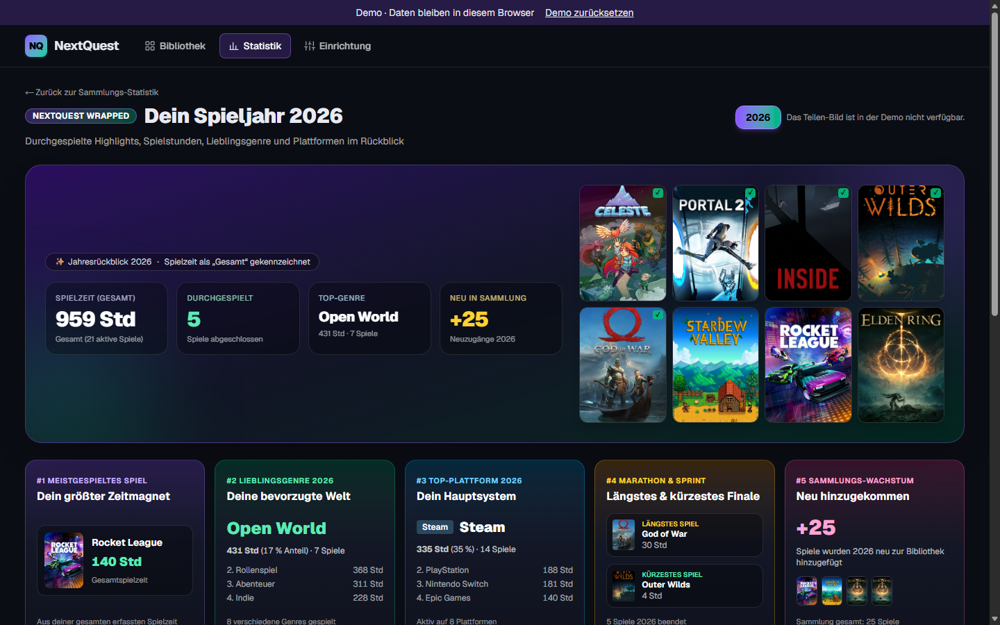
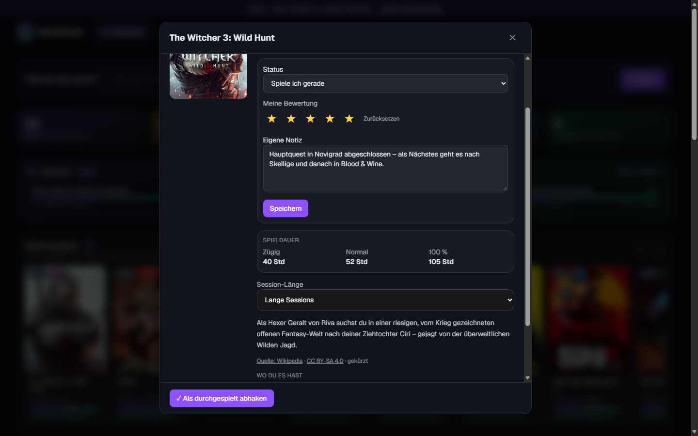
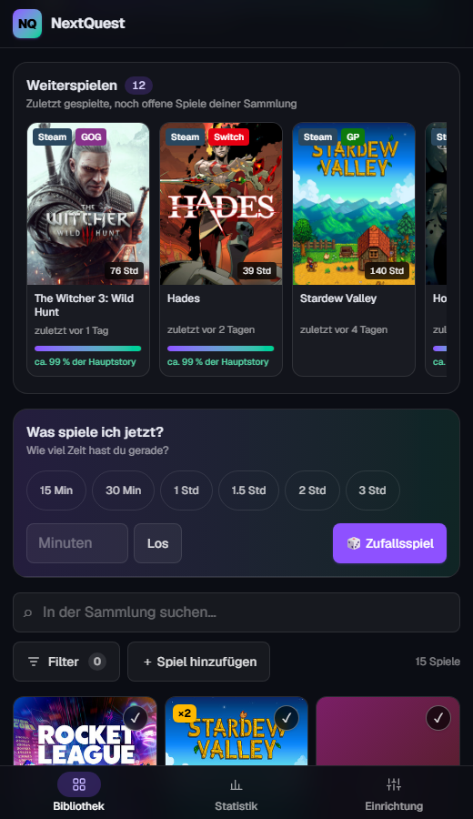
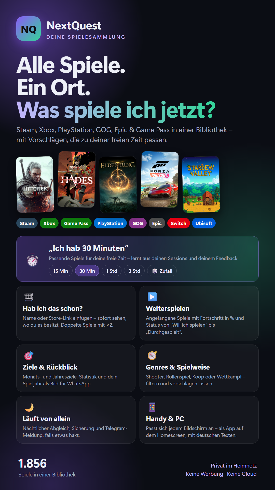

<div align="center">

<h1>🎮 NextQuest</h1>

<h3><strong>Deine Spiele. Eine Bibliothek. Die nächste Quest.</strong></h3>

<p>Deine gesamte Spielesammlung über alle Plattformen hinweg an einem Ort – und die schnelle Antwort auf die Frage: <strong>„Was spiele ich als Nächstes?“</strong></p>

<p>
  <a href="https://strugglechen1337.github.io/NextQuest/"></a>
  <a href="#docker"></a>
  <a href="#-unterstützte-plattformen"></a>
</p>

<h2>👉 <a href="https://strugglechen1337.github.io/NextQuest/"><strong>▶ Online-Demo direkt im Browser ausprobieren</strong></a></h2>
<p><em>Sofort testen – ganz ohne Installation, Anmeldung oder eigene Zugangsdaten.</em></p>

<p>
  
</p>

</div>

> **Hinweis zum Plakat:** Alle sechs großen Plattformen (**Steam, Xbox-Käufe, Xbox Game Pass, PlayStation, GOG und Epic Games**) sowie das **Docker-Image** und die **Online-Demo** sind bereits vollständig fertig und angebunden.

---

## ✨ Was ist NextQuest?

Wer auf PC und Konsole spielt, verteilt seine Sammlung schnell auf ein halbes Dutzend Launcher und Stores – verliert den Überblick über ungespielte Schätze, kauft Spiele versehentlich doppelt und weiß am Feierabend trotzdem nicht, was in die nächsten 45 Minuten passt. **NextQuest** führt deine Bibliotheken von Steam, Xbox, Game Pass, PlayStation, GOG, Epic, Switch und Ubisoft automatisch in einer aufgeräumten, deutschsprachigen Oberfläche zusammen. Die App läuft komplett lokal bei dir zu Hause, reichert deine Sammlung mit Coverbildern, Spielzeiten und Bewertungen an und schlägt dir passend zu deiner freien Zeit genau das richtige Spiel vor.

---

## 📸 Einblicke in die App

<p align="center">
  
  
</p>
<p align="center">
  
  
</p>
<p align="center">
  
  
</p>

---

## 🚀 Funktionen auf einen Blick

- 📚 **Eine Bibliothek für alle Plattformen:** Vereint **Steam**, **Xbox-Käufe**, **Xbox Game Pass** (PC & Konsole), **PlayStation (PS4/PS5)**, **GOG** und **Epic Games** automatisch – ergänzt um manuelle Einträge für **Nintendo Switch** und **Ubisoft Connect**.
- ⏱️ **„Ich hab X Minuten“ & Lernsystem:** Wähle deine verfügbare Zeit (`15 Min`, `30 Min`, `1 Std`, `3 Std` oder frei wählbar) und erhalte begründete Vorschläge (*kurz durchspielbar, fast fertig, ideal für kurze Runden*). Mit **👍 / 👎** lernt NextQuest aus deinem Feedback und deinen Sessions dazu – oder würfelt dir per **🎲 Zufallsspiel** einen offenen Titel aus.
- 🛒 **Mehrfachbesitz (`×2`) & „Hab ich das schon?“:** Vor dem Kauf kurz Spielname oder Store-Link einfügen und sofort sehen, ob du den Titel schon besitzt oder ob er im Game Pass steckt. Mehrfach vorhandene Spiele erscheinen nur einmal in der Bibliothek (mit `×2`-Badge, Plattform-Pills und Filter *„Nur doppelte“*); falsche Zuordnungen lassen sich im Spiel-Dialog abtrennen oder über IGDB neu zuordnen.
- ▶️ **Weiterspielen mit Fortschritt:** Zeigt deine zuletzt gespielten, noch offenen Spiele ganz oben mit geschätztem Hauptstory-Fortschritt in Prozent sowie Erfolgs-/Trophäen-Fortschritt.
- ⭐ **Status, Notizen & eigene Bewertung:** Pflege deinen Backlog mit Status (*Offen, Will ich spielen, Spiele ich gerade, Durchgespielt, Abgebrochen*), eigener 5-Sterne-Bewertung, bevorzugter Session-Länge und persönlichen Notizen. Abgehakte Spiele bleiben in deiner Sammlung, tauchen aber nicht mehr in Vorschlägen auf.
- 🧭 **Genres, Spielweise & starke Filter:** Filtere und kombiniere nach Plattform, Genre (Rollenspiel, Open World, Roguelike, Puzzle …), Spielweise (**Einzelspieler**, **Koop** vs. **Mehrspieler/Wettkampf**), Spieldauer und Game-Pass-Status (inkl. *„Verlässt Game Pass bald“*). Sortiere nach eigener Bewertung, Spielzeit, Beliebtheit, IGDB-Wertung, Kürze oder letztem Spieltag.
- 📊 **Statistik, Ziele & Jahresrückblick zum Teilen:** Behalte Gesamtspielzeit, Plattform- und Genre-Verteilung sowie deinen *Pile of Shame* (inkl. geschätzter Restspielzeit) im Blick. Setze dir Monats-, Jahres- oder Spielziele mit Fortschrittsbalken und erlebe deinen persönlichen **Jahresrückblick (Wrapped)** – inklusive generiertem Bild zum Teilen per WhatsApp oder Story.
- 🇩🇪 **Deutsche Beschreibungen & IGDB-Metadaten:** Lädt automatisch Cover, Spieldauer (*Zügig / Normal / 100 %*), Bewertungen und Beliebtheit über IGDB sowie deutschsprachige Spielbeschreibungen.
- 🌙 **Nächtlicher Abgleich & automatische Sicherung:** Synchronisiert deine Plattformen auf Wunsch jede Nacht von allein, legt vorab automatische SQLite-Backups an und informiert dich optional per Telegram, falls ein Abgleich Aufmerksamkeit braucht.
- 📱 **Handy & PC (PWA):** Passt sich vom großen Desktop-Monitor über das Steam Deck bis zum Smartphone jedem Bildschirm an und lässt sich als Web-App (PWA) direkt auf dem Homescreen installieren.
- 🧙 **Einrichtungsassistent & Demo-Daten:** Alle Zugangsdaten werden Schritt für Schritt direkt in der App eingerichtet und sofort getestet. Zum unverbindlichen Ausprobieren lassen sich jederzeit 25 Beispielspiele laden und rückstandslos wieder entfernen.

---

## 🔌 Unterstützte Plattformen

| Plattform / Dienst | Anbindung | Was wird synchronisiert? |
|---|---|---|
| **Steam** | ✅ Automatisch (Steam Web API) | Gekaufte Spiele, gesamte Spielzeit, zuletzt gespielt & Erfolge |
| **Xbox Game Pass** | ✅ Automatisch (öffentlicher Katalog) | Aktueller PC- & Konsolen-Katalog inkl. *„Verlässt bald“*-Hinweis (kein Login nötig) |
| **Xbox (Käufe)** | ✅ Automatisch (OpenXBL) | Gekaufte Xbox-Spiele, Spielzeit & Gamerscore/Erfolge |
| **PlayStation** | ✅ Automatisch (PSN NPSSO) | PS4- & PS5-Bibliothek, Spielzeit & Trophäen-Fortschritt |
| **GOG** | ✅ Automatisch (GOG-Konto) | Gekaufte Spiele & Spielzeit |
| **Epic Games** | ✅ Automatisch (Epic Auth-Code) | Gekaufte & kostenlose Epic-Spiele |
| **IGDB (Twitch)** | ✅ Automatisch (kostenloser API-Zugang) | Hochauflösende Cover, Spieldauer (HowLongToBeat-Stil), Bewertung, Genres & Spielmodi |
| **Nintendo Switch & Ubisoft** | ✍️ Manuell in der App | Über *„＋ Spiel hinzufügen“* samt Spielzeit eintragbar – wird automatisch mit vorhandenen Exemplaren zusammengeführt |

---

## 📦 Installation – drei Wege

Wähle die Betriebsart, die am besten zu deinem Setup passt:

| Variante | Ideal für | Aufwand | Status |
|---|---|---|---|
| **1. Windows-App** | Einsteiger & Desktop-PCs (inkl. Handy-Zugriff per QR-Code) | Setup starten, fertig | ✅ [Download v0.1.0](https://github.com/Strugglechen1337/NextQuest/releases/latest) |
| **2. Docker** | NAS (Synology, Unraid), Raspberry Pi, Heimserver (`amd64` & `arm64`) | **3 Befehle** ohne Klonen/Bauen | ✅ Bereit (`ghcr.io`) |
| **3. Linux nativ** | Eigener Linux-Server / LXC / VM mit `systemd` & Node 22 | Skript- & Service-Setup | ✅ Bereit ([`deploy/README.md`](deploy/README.md)) |

### 1. Windows-App


Das Setup `NextQuest-Setup-<Version>.exe` steht in den [GitHub-Releases](https://github.com/Strugglechen1337/NextQuest/releases) bereit. Das Setup ist nicht signiert; Windows SmartScreen kann deshalb warnen. Über „Weitere Informationen“ und „Trotzdem ausführen“ lässt sich die Installation fortsetzen.

Beim ersten Start kann der Datenordner gewählt werden; standardmäßig liegt er unter `%LOCALAPPDATA%\NextQuest\data`. Wenn Windows nach Netzwerkzugriff fragt, privates Netzwerk erlauben. Die App bleibt beim Schließen des Fensters im Infobereich aktiv und kann so die geplanten Aufgaben ausführen.

Im Infobereich „Auf dem Handy öffnen“ wählen und den QR-Code mit einem Handy im selben WLAN scannen. Dort stehen auch Adresse und Passwort; der Benutzername ist beliebig. Im Handy-Browser kann NextQuest zum Startbildschirm hinzugefügt werden. Die Verbindung im Heimnetz ist nicht verschlüsselt.

Updates werden über GitHub Releases angeboten und vor der Installation wird eine Sicherung erstellt. Die Deinstallation entfernt die Anwendung, behält aber den Datenordner; diesen bei Bedarf selbst löschen.

## Docker

Für NAS, Raspberry Pi und Heimserver steht ein fertiges Multi-Arch-Image (`linux/amd64` + `linux/arm64`) unter `ghcr.io/strugglechen1337/nextquest` in der GitHub Container Registry bereit – ohne Klonen oder eigenes Bauen in **3 Befehlen bis zum Start**:

```bash
mkdir nextquest && cd nextquest
curl -fsSLO https://raw.githubusercontent.com/Strugglechen1337/NextQuest/main/docker-compose.yml
docker compose up -d
```

Danach im Browser `http://<server-ip>:3000` öffnen und unter **Einrichtung** die gewünschten Plattformen verbinden.

- **Datenordner (`/data`):** Alle Daten (SQLite-Datenbank `nextquest.db`, Plattform-Zugangsdaten, Einstellungen und Backups) liegen im Container unter `/data` – in [`docker-compose.yml`](docker-compose.yml) als Volume `nextquest-data:/data` eingebunden – und bleiben bei Updates erhalten.
- **Passwort (`APP_PASSWORD`):** Optionaler Zugriffsschutz fürs Heimnetz per Umgebungsvariable `APP_PASSWORD` (z. B. über eine `.env`-Datei neben `docker-compose.yml`, siehe [`.env.example`](.env.example); Port über `NEXTQUEST_PORT`, Zeitzone `TZ=Europe/Berlin`). Der Browser fragt dann nach dem Passwort (Benutzername beliebig). `GET /api/health` bleibt für den Container-Healthcheck frei.
- **Updates:** Neues Image laden und Container neu starten:
  ```bash
  docker compose pull && docker compose up -d
  ```
  Für vollautomatische Updates kann in [`docker-compose.yml`](docker-compose.yml) der vorbereitete **Watchtower**-Block einkommentiert werden.
- **Sicherung (`/data/backups`):** NextQuest sichert die Datenbank selbstständig nach `/data/backups` (innerhalb des `/data`-Volumes) und bietet das Anlegen von Sicherungen direkt in der App an. Für ein externes Host-Backup genügt es, das Volume bzw. `/data/backups` wegzusichern.
- Weitere Details zum Docker-Betrieb und zu den Endpunkten (`/api/health`, `/api/version`): [`docs/HERMES.md`](docs/HERMES.md).

### 3. Linux nativ (ohne Docker)

Auf einem eigenen Linux-Server (Node 22 + Next.js-Standalone-Build) kann NextQuest direkt über `systemd`-User-Dienste betrieben werden – inklusive vorgeschaltetem PIN-Gate, automatischem In-App-Updater mit Rollback-Sicherung, nächtlichen SQLite-Online-Snapshots und Verfügbarkeits-Monitoring. Die vollständige Anleitung befindet sich in [`deploy/README.md`](deploy/README.md).

---

## 🔒 Datenschutz & Hinweis zu Schnittstellen

- **Deine Daten bleiben bei dir:** Alle Plattform-Zugangsdaten, Token und deine Spielesammlung werden ausschließlich lokal in deiner eigenen SQLite-Datenbank (`./data/nextquest.db` bzw. `/data/nextquest.db`) gespeichert.
- **Keine Cloud, keine Werbung, kein Tracking:** Es gibt kein Benutzerkonto bei Dritten und keine Analyse-Dienste. Die App kommuniziert nur direkt von deinem Gerät bzw. Heimserver mit den jeweiligen Spieleplattformen (sowie IGDB/Wikipedia für Metadaten).
- **Wichtiger Hinweis zu inoffiziellen Schnittstellen:** Während Steam und IGDB offizielle APIs bereitstellen, nutzen die Anbindungen für **PlayStation (PSN), Epic Games, GOG und Xbox (OpenXBL)** teilweise inoffizielle bzw. von der Community dokumentierte Schnittstellen. Die Nutzung erfolgt **auf eigene Verantwortung** und ist ausschließlich für den **privaten Gebrauch** im eigenen Heimnetz gedacht.

---

## 🛠️ Entwicklung & Mitwirken

Voraussetzung für die lokale Entwicklung ist **Node.js 22+** (nutzt das eingebaute `node:sqlite`-Modul ohne native C++-Abhängigkeiten):

```bash
npm install
npm run dev     # Startet den Entwicklungsserver auf http://localhost:3000
npm test        # Führt die Test-Suite aus
npm run lint    # Prüft Code-Stil und TypeScript-Regeln
```

Die lokale SQLite-Datenbank wird automatisch unter `./data/nextquest.db` angelegt (in `.gitignore` ausgeschlossen). Einen statischen Demo-Export (wie auf GitHub Pages) erzeugst du mit `npm run build:demo` nach `./out`.

**Tech-Stack:** Next.js 16 (App Router, TypeScript) · React 19 · Tailwind CSS 4 · SQLite über `node:sqlite` (Node 22).

Fehlerberichte, Ideen und Pull Requests sind herzlich willkommen!

---

<details>
<summary>📱 <b>Teilen-Grafik (Story-Plakat im Hochformat für WhatsApp / Social Media)</b></summary>
<br />
<div align="center">
  
</div>
</details>
